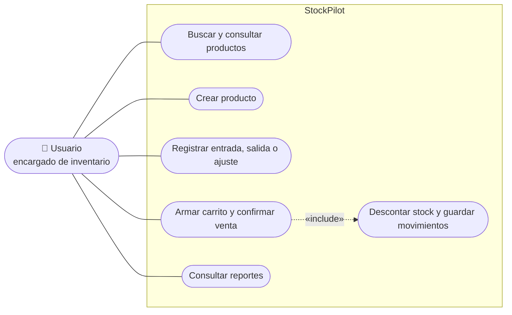
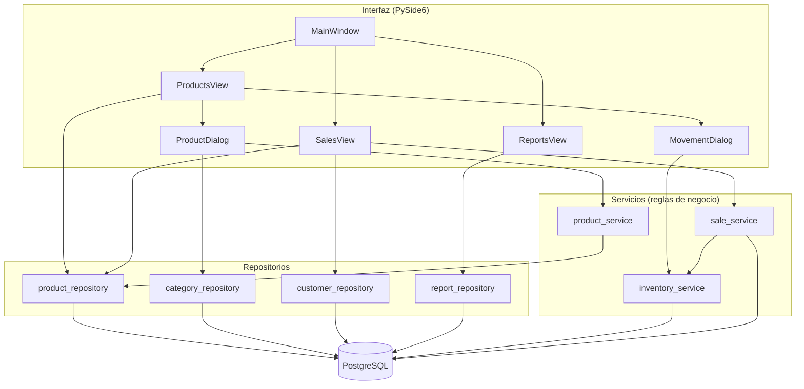
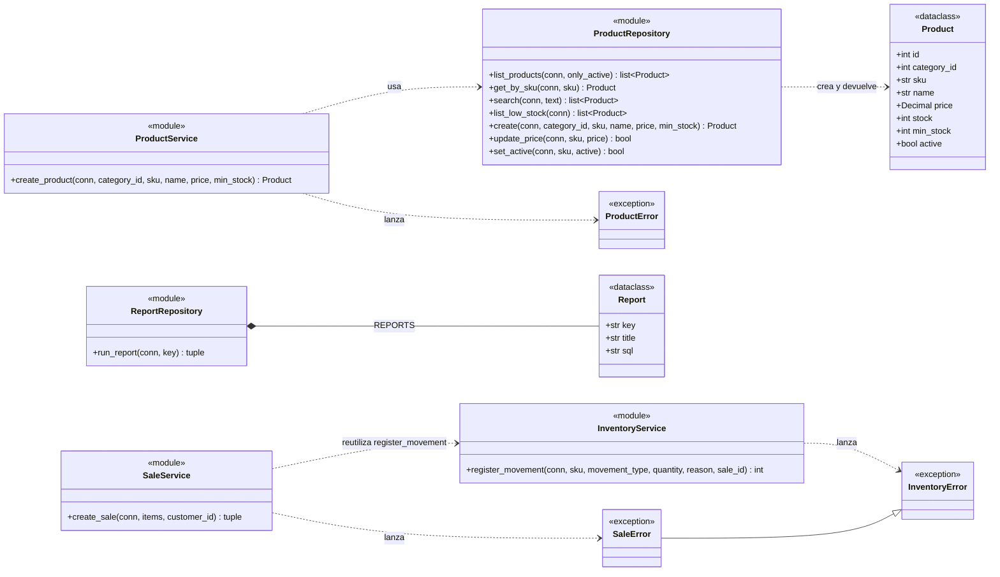
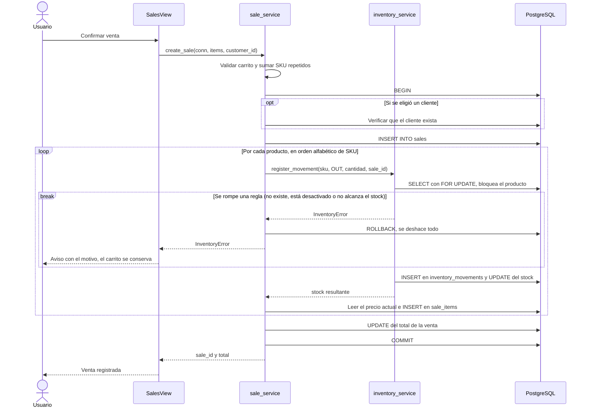
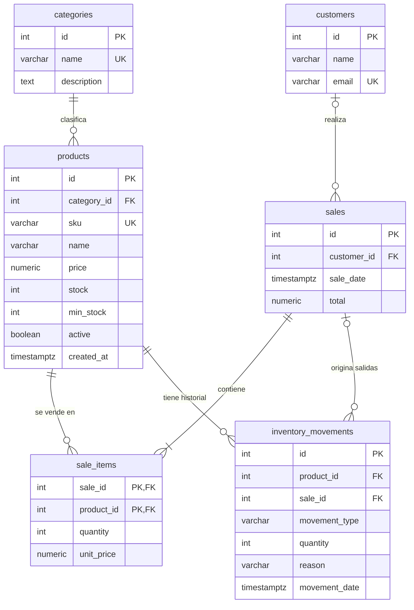

# StockPilot


Aplicación de escritorio para gestionar **inventario y ventas**, construida con Python, PySide6 y PostgreSQL. Permite administrar productos, registrar movimientos de stock, vender con un carrito y consultar reportes. Las ventas se guardan en transacciones, de modo que la base de datos nunca queda inconsistente.

## Contenido

1. [Descripción](#descripción)
2. [Capturas](#capturas)
3. [Requisitos](#requisitos)
4. [Arquitectura](#arquitectura)
5. [Diagramas UML](#diagramas-uml)
6. [Modelo de datos](#modelo-de-datos)
7. [Decisiones de diseño](#decisiones-de-diseño)
8. [Estructura del proyecto](#estructura-del-proyecto)
9. [Instalación](#instalación)
10. [Pruebas](#pruebas)
11. [Mejoras futuras](#mejoras-futuras)
12. [Autor](#autor)

## Descripción

StockPilot resuelve un problema común en pequeños negocios: saber cuánto hay de cada producto, registrar lo que se vende y detectar a tiempo lo que se está agotando. El proyecto se diseñó para demostrar:

- Modelado relacional con claves, restricciones e índices.
- Operaciones transaccionales y control de concurrencia.
- Arquitectura por capas con responsabilidades separadas.
- Pruebas automáticas contra una base de datos real.

## Capturas

| Productos | Ventas | Reportes |
|---|---|---|
|  |  |  |

## Requisitos

### Requisitos funcionales

| ID | Requisito | Estado |
|---|---|---|
| RF-01 | Crear productos con SKU único y buscarlos por nombre o SKU | ✅ Implementado |
| RF-02 | Desactivar productos y editar su precio | 🟡 Lógica lista, sin botón en la interfaz |
| RF-03 | Registrar entradas, salidas y ajustes de inventario, con motivo | ✅ Implementado |
| RF-04 | Resaltar los productos con stock por debajo del mínimo | ✅ Implementado |
| RF-05 | Registrar ventas con varios productos y cliente opcional | ✅ Implementado |
| RF-06 | Consultar cinco reportes (ventas por día, más vendidos, valor del inventario, stock bajo, ventas por cliente) | ✅ Implementado |
| RF-07 | Conservar el historial de movimientos y ventas | 🟡 Se guarda en la base, sin pantalla de consulta |

### Reglas de negocio

| ID | Regla |
|---|---|
| RN-01 | El SKU es único; precio, stock y stock mínimo no pueden ser negativos |
| RN-02 | La cantidad de una venta o movimiento debe ser mayor que cero (los ajustes admiten negativos, pero no cero) |
| RN-03 | No se puede sacar ni vender más stock del que hay, ni mover productos desactivados |
| RN-04 | Una venta es **atómica**: o se guarda completa (venta, ítems, movimientos y stock) o no se guarda nada |
| RN-05 | El precio de cada ítem se guarda al vender, así que cambiar el precio después no altera las ventas antiguas |
| RN-06 | El stock de un producto coincide con la suma de sus movimientos (entradas en positivo, salidas en negativo) |
| RN-07 | Los productos no se borran: se desactivan, para conservar el historial |
| RN-08 | Si un SKU se repite en el carrito, las cantidades se suman en una sola línea |

### Requisitos no funcionales

| Atributo | Cómo se cumple |
|---|---|
| Integridad | Transacciones y restricciones `CHECK`, `UNIQUE` y de clave foránea en la base de datos |
| Concurrencia | `SELECT ... FOR UPDATE` y bloqueo de productos en orden alfabético de SKU |
| Seguridad | Consultas parametrizadas (sin inyección SQL), credenciales en `.env` fuera del repositorio y un usuario de base de datos propio para la aplicación |
| Mantenibilidad | Arquitectura por capas: la interfaz no contiene reglas de negocio |
| Verificabilidad | 30 pruebas automáticas contra PostgreSQL |

## Arquitectura

El código se organiza en capas. Cada una depende solo de la inferior:

```
Interfaz (ui)  →  Servicios  →  Repositorios  →  PostgreSQL
 ventanas y        reglas de      consultas        datos
 formularios       negocio        de lectura
```

| Capa | Carpeta | Responsabilidad |
|---|---|---|
| Interfaz | `ui/` | Ventanas y formularios con PySide6; no contiene SQL ni reglas de negocio |
| Servicios | `services/` | Reglas de negocio, validaciones y control de transacciones |
| Repositorios | `repositories/` | Consultas SQL de lectura y operaciones simples |
| Modelos | `models/` | Estructuras de datos, como `Product` |

## Diagramas UML

### Casos de uso



### Componentes y dependencias entre capas



Los servicios de inventario y ventas ejecutan sus propias consultas porque deben leer, validar y escribir dentro de una misma transacción con la fila del producto bloqueada.

### Diagrama de clases: negocio y acceso a datos



### Secuencia: confirmar una venta



## Modelo de datos

### Diagrama entidad-relación



### Relaciones

| Relación | Cardinalidad | Clave foránea | ¿Obligatoria? | Significado |
|---|---|---|---|---|
| `categories` → `products` | 1 : N | `products.category_id` | Sí | Todo producto pertenece a una categoría |
| `customers` → `sales` | 0..1 : N | `sales.customer_id` | No | Una venta puede no tener cliente (`NULL`) |
| `sales` → `sale_items` | 1 : N | `sale_items.sale_id` | Sí | Una venta tiene al menos un ítem (lo exige `create_sale`) |
| `products` → `sale_items` | 1 : N | `sale_items.product_id` | Sí | Cada ítem corresponde a un producto |
| `sales` ↔ `products` | N : M | tabla asociativa `sale_items` | — | Una venta incluye varios productos y un producto aparece en varias ventas; la clave primaria compuesta `(sale_id, product_id)` impide repetir un producto en la misma venta |
| `products` → `inventory_movements` | 1 : N | `inventory_movements.product_id` | Sí | Historial completo de cada producto |
| `sales` → `inventory_movements` | 0..1 : N | `inventory_movements.sale_id` | No | Las salidas por venta apuntan a su venta; las entradas y ajustes no |

Ninguna clave foránea usa `ON DELETE CASCADE`: la base no permite borrar un producto o una venta que tengan registros relacionados.

### Restricciones de integridad

| Tabla | Restricción |
|---|---|
| `categories` | `name` único |
| `products` | `sku` único; `price >= 0`; `stock >= 0`; `min_stock >= 0`; `active` por defecto `TRUE` |
| `customers` | `email` único (admite `NULL`) |
| `sales` | `total >= 0` |
| `sale_items` | `quantity > 0`; `unit_price >= 0`; clave primaria compuesta |
| `inventory_movements` | `movement_type` solo `IN`, `OUT` o `ADJUST`; la cantidad debe ser positiva en `IN`, negativa en `OUT` y distinta de cero en `ADJUST` |

### Índices

| Índice | Columna | Para qué sirve |
|---|---|---|
| `idx_products_category` | `products.category_id` | Reportes por categoría y uniones con `categories` |
| `idx_sales_date` | `sales.sale_date` | Reporte de ventas por día |
| `idx_sale_items_product` | `sale_items.product_id` | Productos más vendidos |
| `idx_movements_product` | `inventory_movements.product_id` | Historial de un producto |

## Decisiones de diseño

| Decisión | Alternativa descartada | Motivo |
|---|---|---|
| Guardar el stock en `products` y el historial en `inventory_movements` | Calcular el stock sumando movimientos en cada consulta | Lectura rápida del stock; el historial sirve de auditoría y una prueba verifica que ambos coinciden |
| Copiar el precio en `sale_items.unit_price` | Leer siempre el precio actual del producto | Las ventas antiguas no cambian si el precio se modifica |
| Desactivar productos (`active`) | Borrarlos | Las claves foráneas impiden borrar productos con historial, y los reportes lo necesitan |
| `NUMERIC` en SQL y `Decimal` en Python | `float` | Los decimales de coma flotante producen errores de redondeo con dinero |
| `SELECT ... FOR UPDATE` al mover stock | Sin bloqueo | Dos ventas simultáneas de la última unidad dejarían el stock en negativo |
| Bloquear los productos en orden alfabético de SKU | Orden de llegada | Un orden fijo evita bloqueos cruzados (*deadlocks*) entre ventas simultáneas |
| Servicios de inventario y ventas con SQL propio | Repositorios puros sin lógica | Leer, validar y escribir debe ocurrir con la fila bloqueada y en la misma transacción |
| Repositorios sin `commit` | Confirmar en cada función | El servicio decide qué operaciones forman una transacción |
| Una conexión corta por operación | Una conexión global abierta | Evita transacciones olvidadas y simplifica el manejo de errores |
| Validar en el servicio y también en la base (`CHECK`) | Validar en un solo lugar | El servicio da mensajes claros; la base es la última defensa si el código falla |
| Pruebas contra PostgreSQL real con `rollback` | Pruebas con datos simulados | Verifican restricciones, transacciones y SQL de verdad, sin ensuciar los datos |

## Estructura del proyecto

```
stockpilot/
├── src/stockpilot/
│   ├── main.py                    punto de entrada
│   ├── config.py                  lectura del .env
│   ├── database/
│   │   └── connection.py          conexión a PostgreSQL
│   ├── models/
│   │   └── product.py
│   ├── repositories/
│   │   ├── product_repository.py
│   │   ├── category_repository.py
│   │   ├── customer_repository.py
│   │   └── report_repository.py
│   ├── services/
│   │   ├── product_service.py
│   │   ├── inventory_service.py
│   │   └── sale_service.py
│   └── ui/
│       ├── main_window.py
│       ├── products_view.py
│       ├── sales_view.py
│       ├── reports_view.py
│       ├── product_dialog.py
│       └── movement_dialog.py
├── tests/
├── database/
│   ├── schema.sql                 tablas, restricciones e índices
│   ├── seed.sql                   datos de ejemplo
│   └── reports.sql                consultas de reportes
├── docs/screenshots/
├── .env.example
├── pytest.ini
└── requirements.txt
```

## Instalación

### Requisitos previos

- Python 3.12 o superior
- PostgreSQL 18 (otras versiones recientes deberían funcionar)
- Git

### Pasos (Windows, PowerShell)

1. Clona el repositorio y prepara el entorno virtual:

   ```powershell
   git clone https://github.com/juanesz333/stockpilot.git
   cd stockpilot
   python -m venv .venv
   .\.venv\Scripts\Activate.ps1
   pip install -r requirements.txt
   ```

   Si PowerShell bloquea la activación, ejecuta una vez `Set-ExecutionPolicy -Scope CurrentUser RemoteSigned`.

2. Crea el usuario y la base de datos en PostgreSQL (cambia la contraseña):

   ```sql
   CREATE ROLE stockpilot_app LOGIN PASSWORD 'cambia_esta_clave';
   CREATE DATABASE stockpilot OWNER stockpilot_app;
   ```

3. Conectado a la base `stockpilot`, ejecuta los scripts de la carpeta `database/`:

   - `schema.sql`: crea las tablas.
   - `seed.sql`: carga datos de ejemplo. **Atención:** empieza con `TRUNCATE` y borra todos los datos de las tablas.
   - `reports.sql`: consultas de reportes para probar en un cliente SQL (opcional).

4. Copia `.env.example` como `.env` y pon tus datos de conexión:

   ```
   DB_HOST=localhost
   DB_PORT=5432
   DB_NAME=stockpilot
   DB_USER=stockpilot_app
   DB_PASSWORD=cambia_esta_clave
   ```

   El archivo `.env` está en `.gitignore` y nunca se sube al repositorio.

5. Ejecuta la aplicación:

   ```powershell
   $env:PYTHONPATH = "src"
   python -m stockpilot.main
   ```

   En Linux o macOS: `PYTHONPATH=src python -m stockpilot.main`.

## Pruebas

```powershell
pytest -v
```

Las pruebas se ejecutan contra la base de datos real y **deshacen todo al terminar** (`rollback`), así que no ensucian los datos. Necesitan que `seed.sql` esté cargado.

| Archivo | Qué verifica | Pruebas |
|---|---|---|
| `test_connection.py` | Conexión y existencia de las seis tablas | 2 |
| `test_products.py` | Listar, crear, SKU duplicado, búsqueda y productos desactivados | 5 |
| `test_product_service.py` | Validaciones de creación de productos | 4 |
| `test_inventory.py` | Entradas, salidas, stock insuficiente y coherencia con el historial | 6 |
| `test_sales.py` | Total, precio histórico, SKU repetido y que una venta fallida **no deja nada a medias** | 5 |
| `test_reports.py` | Los cinco reportes y su coherencia con las ventas | 8 |
| **Total** | | **30** |

## Mejoras futuras

- [ ] Desactivar productos y editar precios desde la interfaz (la capa de datos ya lo soporta)
- [ ] Pantalla de historial de movimientos y detalle de cada venta
- [ ] Gestión de clientes desde la interfaz
- [ ] Exportar reportes a CSV
- [ ] Integración continua con GitHub Actions
- [ ] Empaquetar la aplicación como ejecutable (.exe)

## Autor

Juan Esteban Fernández Segura · [GitHub](https://github.com/juanesz333)