# StockPilot: documentación UML

Diagramas del proyecto, de lo más general a lo más detallado. Se dibujan con [Mermaid](https://mermaid.js.org/), que GitHub muestra directamente.

**Convenciones:** Python usa módulos con funciones en lugar de clases para los servicios y repositorios. Aquí aparecen como clases con el estereotipo `<<module>>`, y sus funciones como métodos. Las clases de Qt llevan `<<PySide6>>`.

## Contenido

1. [Vista de paquetes](#1-vista-de-paquetes)
2. [Modelo de dominio](#2-modelo-de-dominio)
3. [Modelo físico de datos](#3-modelo-físico-de-datos)
4. [Clases: infraestructura y acceso a datos](#4-clases-infraestructura-y-acceso-a-datos)
5. [Clases: servicios y excepciones](#5-clases-servicios-y-excepciones)
6. [Clases: interfaz de usuario](#6-clases-interfaz-de-usuario)
7. [Casos de uso](#7-casos-de-uso)
8. [Diagramas de secuencia](#8-diagramas-de-secuencia)
9. [Diagrama de actividad: registrar un movimiento](#9-diagrama-de-actividad-registrar-un-movimiento)
10. [Diagrama de estados: producto](#10-diagrama-de-estados-producto)
11. [Diagrama de despliegue](#11-diagrama-de-despliegue)

## 1. Vista de paquetes

Muestra qué módulo usa a cuál. La interfaz nunca consulta la base de datos directamente: pasa por servicios y repositorios.

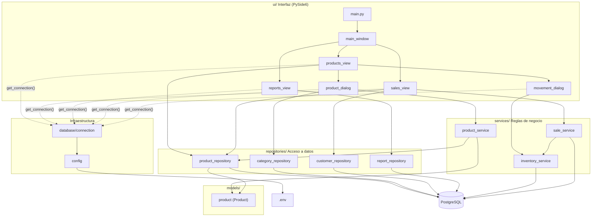

Los servicios de inventario y ventas ejecutan sus propias consultas porque deben leer, validar y escribir dentro de una misma transacción, con la fila del producto bloqueada.

## 2. Modelo de dominio

Las entidades del negocio y sus asociaciones, en notación UML de clases. Es un modelo conceptual: las claves foráneas no aparecen como atributos porque las expresan las asociaciones (el modelo físico está en la sección 3).

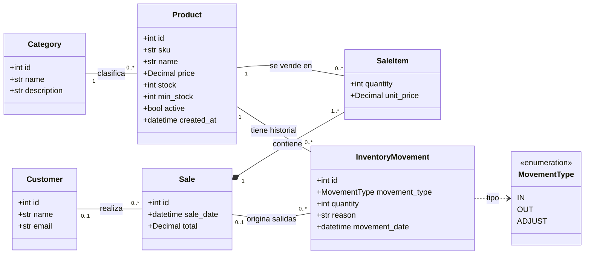

- `SaleItem` es la clase asociativa entre `Sale` y `Product`: una venta incluye varios productos y un producto aparece en varias ventas. No puede haber dos líneas del mismo producto en una venta.
- `SaleItem.unit_price` guarda el precio del momento de la venta.
- El `stock` de un `Product` es la suma de las cantidades de sus `InventoryMovement`: las entradas son positivas y las salidas negativas.
- Una venta puede no tener cliente (`0..1`), y un movimiento puede no venir de una venta (`0..1`), como las entradas y los ajustes.
- La clase `Product` del código (`models/product.py`) no incluye `created_at`: el repositorio no lo lee.

## 3. Modelo físico de datos

Las seis tablas de PostgreSQL, con tipos, claves y restricciones. Mermaid no admite coma dentro del tipo, así que la precisión de `NUMERIC(12,2)` va en el comentario.

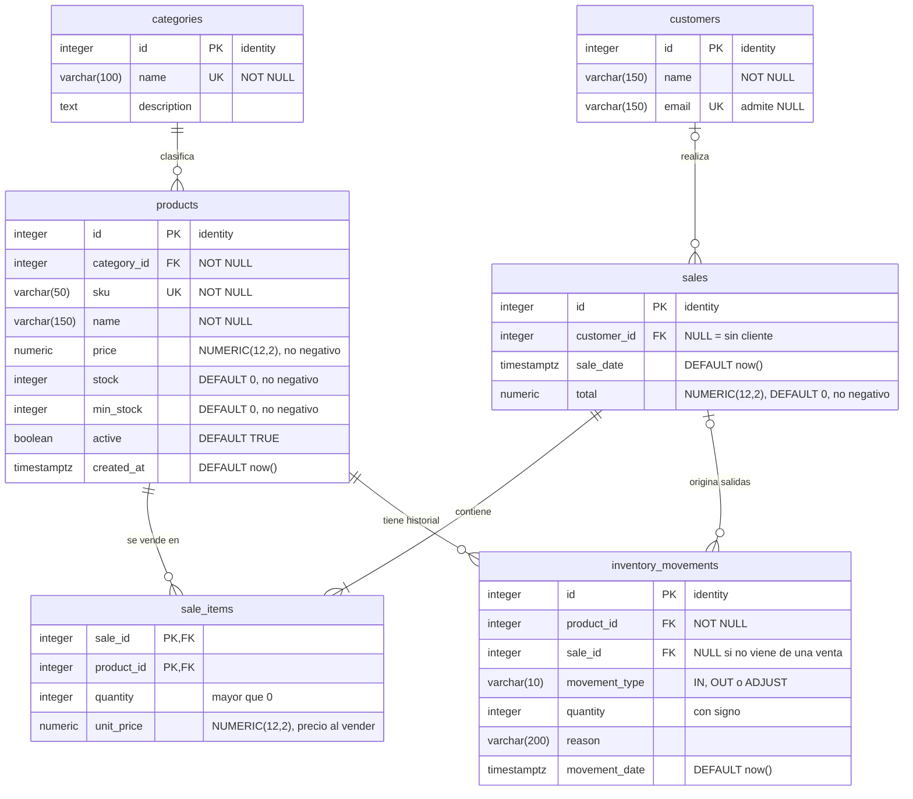

### Relaciones y claves foráneas

| Relación | Cardinalidad | Clave foránea | ¿Obligatoria? |
|---|---|---|---|
| `categories` → `products` | 1 : N | `products.category_id` | Sí |
| `customers` → `sales` | 0..1 : N | `sales.customer_id` | No |
| `sales` → `sale_items` | 1 : N | `sale_items.sale_id` | Sí |
| `products` → `sale_items` | 1 : N | `sale_items.product_id` | Sí |
| `products` → `inventory_movements` | 1 : N | `inventory_movements.product_id` | Sí |
| `sales` → `inventory_movements` | 0..1 : N | `inventory_movements.sale_id` | No |

Ninguna clave foránea usa `ON DELETE CASCADE`: la base no permite borrar un producto o una venta que tengan registros relacionados.

### Restricciones de integridad

| Tabla | Restricción |
|---|---|
| `categories` | `name` único |
| `products` | `sku` único; `price >= 0`; `stock >= 0`; `min_stock >= 0` |
| `customers` | `email` único (admite `NULL`) |
| `sales` | `total >= 0` |
| `sale_items` | `quantity > 0`; `unit_price >= 0`; clave primaria compuesta `(sale_id, product_id)` |
| `inventory_movements` | `movement_type` en (`IN`, `OUT`, `ADJUST`); cantidad positiva en `IN`, negativa en `OUT` y distinta de cero en `ADJUST` |

### Índices

| Índice | Columna | Para qué sirve |
|---|---|---|
| `idx_products_category` | `products.category_id` | Reportes por categoría |
| `idx_sales_date` | `sales.sale_date` | Reporte de ventas por día |
| `idx_sale_items_product` | `sale_items.product_id` | Productos más vendidos |
| `idx_movements_product` | `inventory_movements.product_id` | Historial de un producto |

## 4. Clases: infraestructura y acceso a datos

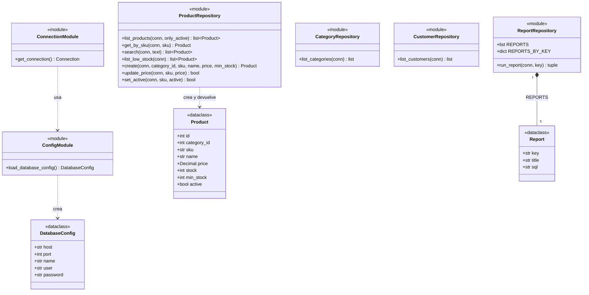

- `DatabaseConfig` y `Report` son `dataclass` inmutables (`frozen=True`).
- Todas las funciones de los repositorios reciben una conexión de psycopg y **no hacen `commit`**: quien las llama decide qué operaciones forman una transacción.
- `update_price` y `set_active` existen en la capa de datos, pero la interfaz aún no tiene botones para ellas.

## 5. Clases: servicios y excepciones

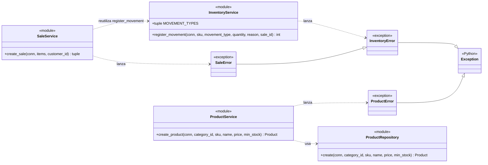

- `SaleError` hereda de `InventoryError`: la interfaz atrapa ambos con un solo `except InventoryError`.
- `create_sale` devuelve una tupla `(sale_id, total)`, y `register_movement` devuelve el stock resultante.
- `register_movement` y `create_sale` abren una transacción (`with conn.transaction()`), y bloquean los productos con `SELECT ... FOR UPDATE`.

## 6. Clases: interfaz de usuario

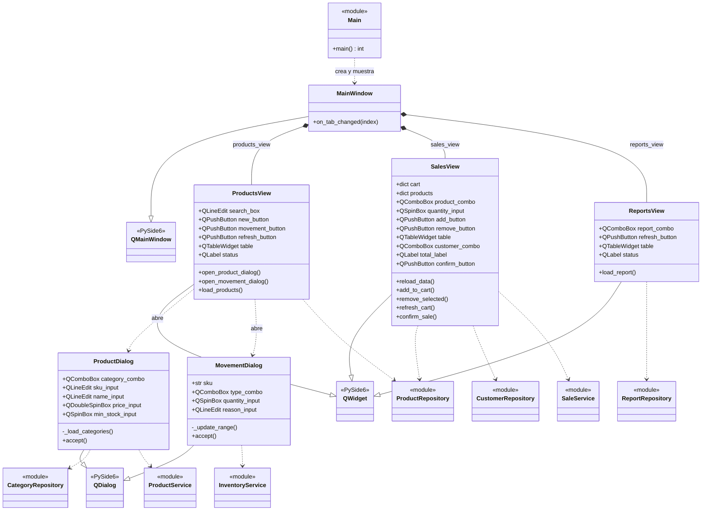

- Los atributos son los widgets que cada pantalla guarda; los métodos son los *slots* conectados a señales (`clicked`, `textChanged`, `currentChanged`).
- `MovementDialog` recibe `sku`, `name` y `stock` al crearse, para mostrar el producto seleccionado.
- `SalesView.cart` es un diccionario `sku → [producto, cantidad]` que vive en memoria hasta confirmar la venta.
- `sales_view.py` define la función auxiliar `money()` y `reports_view.py` la función `format_value()`, ambas a nivel de módulo.
- Ninguna clase de interfaz contiene SQL ni reglas de negocio.

## 7. Casos de uso

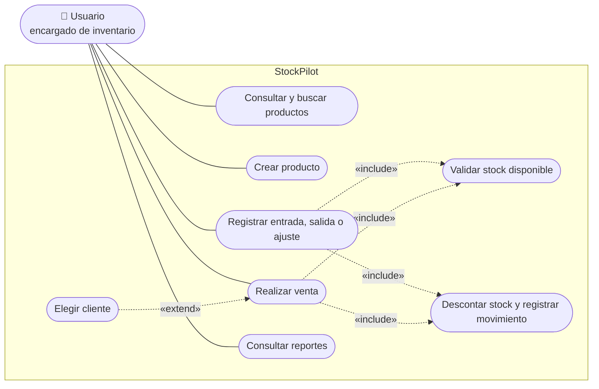

Mermaid no tiene diagrama de casos de uso propio, así que este se dibuja con un diagrama de flujo que imita la notación: el actor a la izquierda, los casos de uso dentro del sistema y las relaciones `include` y `extend` con líneas punteadas.

| ID | Caso de uso | Precondición | Flujo principal | Errores y alternativas |
|---|---|---|---|---|
| CU-01 | Consultar y buscar productos | Ninguna | Abrir la pestaña Productos y escribir en la caja de búsqueda | Si la base no responde, se muestra un aviso. Los productos bajo su mínimo salen en rojo |
| CU-02 | Crear producto | Existe al menos una categoría | Pulsar Nuevo producto, completar categoría, SKU, nombre, precio y mínimo, y aceptar | SKU repetido, nombre vacío o precio negativo: aviso y el formulario sigue abierto. El SKU se guarda en mayúsculas y el stock empieza en 0 |
| CU-03 | Registrar entrada, salida o ajuste | Hay un producto seleccionado | Pulsar Registrar movimiento, elegir tipo, cantidad y motivo, y aceptar | Sin selección, cantidad inválida, producto desactivado o stock insuficiente: aviso y no cambia nada |
| CU-04 | Realizar venta | Hay productos con stock | Elegir producto y cantidad, agregar al carrito, opcionalmente elegir cliente y confirmar | Carrito vacío o stock insuficiente: aviso y el carrito se conserva. Si algo falla, no se guarda nada |
| CU-05 | Consultar reportes | Ninguna | Elegir un reporte en la lista; la tabla se actualiza | Si la base no responde, se muestra un aviso |

## 8. Diagramas de secuencia

### 8.1 Crear un producto

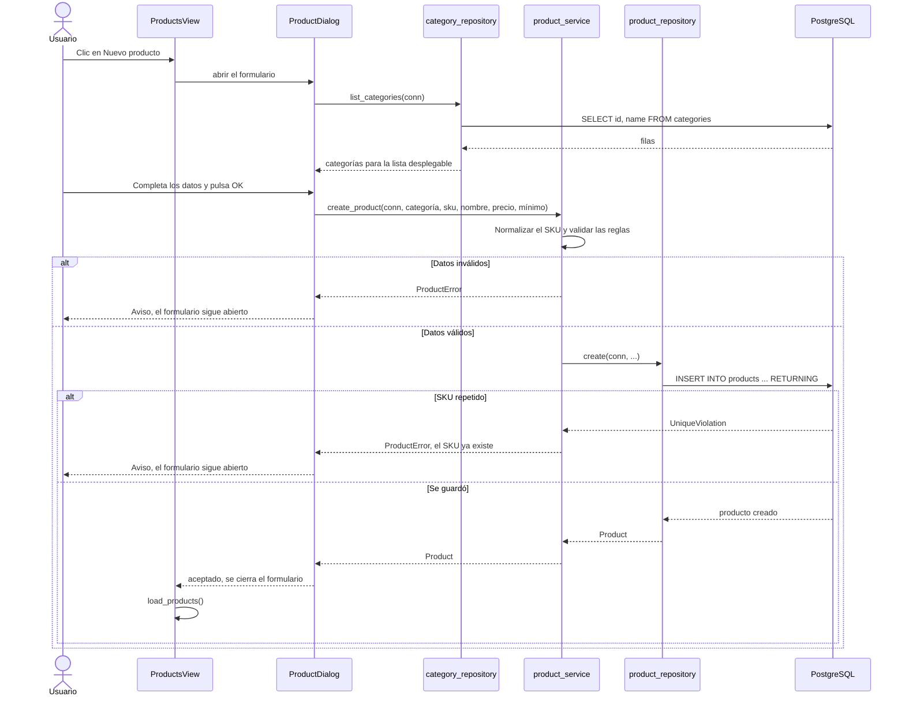

### 8.2 Registrar un movimiento de inventario

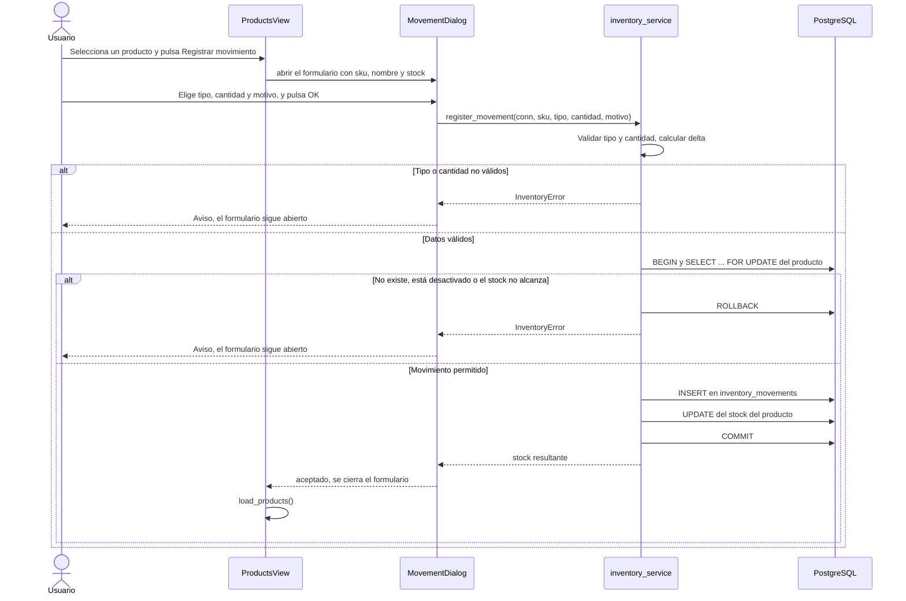

### 8.3 Confirmar una venta

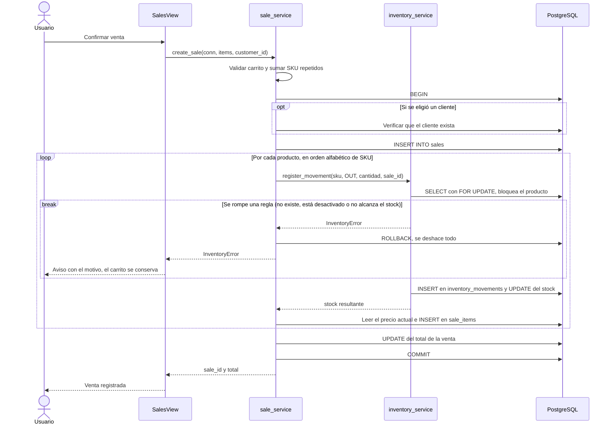

> Las validaciones previas (carrito vacío, cantidad no válida) y la verificación del cliente también cancelan la venta con `SaleError`, que hereda de `InventoryError`. Las instrucciones `BEGIN`, `COMMIT` y `ROLLBACK` las emite `conn.transaction()`; se dibujan como mensajes de `sale_service` por claridad.

### 8.4 Consultar un reporte

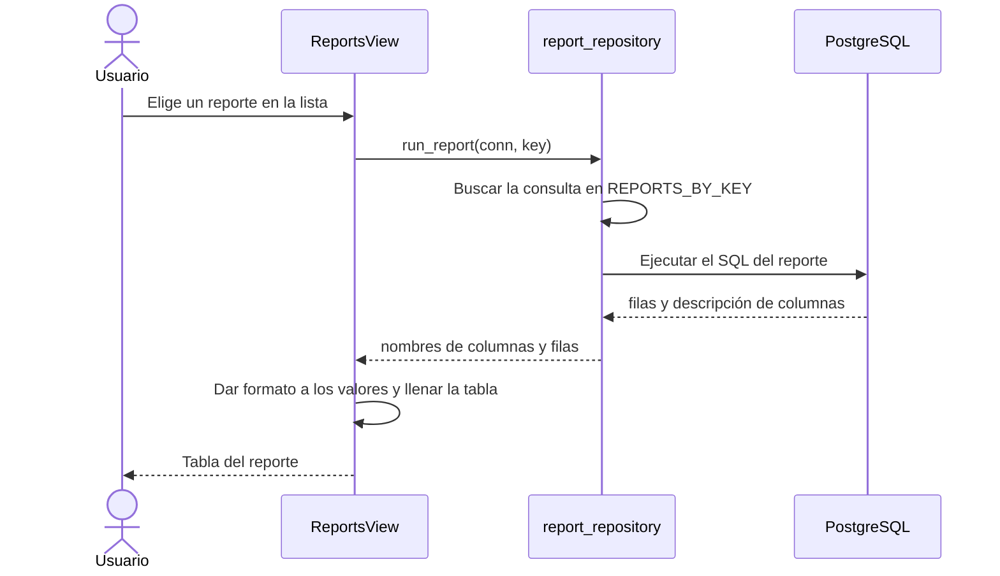

## 9. Diagrama de actividad: registrar un movimiento

La lógica de decisión de `register_movement`. Los errores posteriores a `BEGIN` deshacen la transacción.

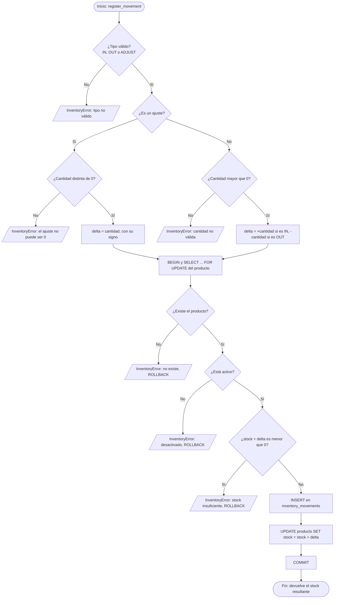

## 10. Diagrama de estados: producto

Ciclo de vida de un producto, con el estado de su stock mientras está activo.

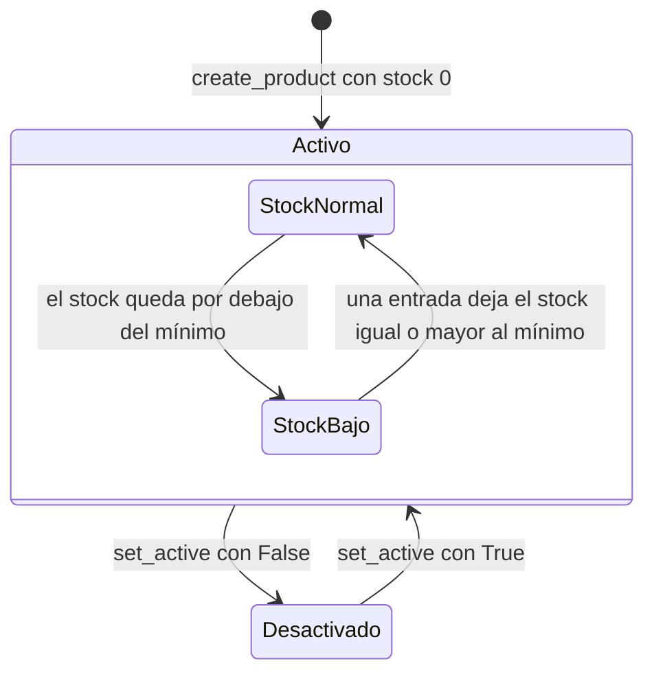

- Un producto recién creado tiene stock 0. Queda en `StockBajo` si su mínimo es mayor que 0, y en `StockNormal` si el mínimo es 0.
- En `StockBajo` el producto aparece en rojo en la pantalla de productos y en el reporte de stock bajo.
- Un producto `Desactivado` no aparece en los listados ni acepta movimientos ni ventas (regla RN-03).
- `set_active` existe en el repositorio, pero la interfaz aún no tiene el botón.

## 11. Diagrama de despliegue

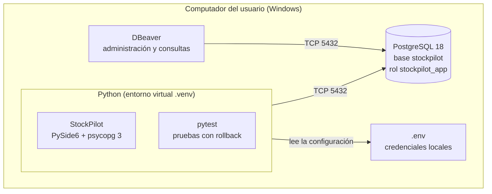

Por defecto todo corre en el mismo computador (`localhost`). Si PostgreSQL estuviera en otro servidor, solo cambiaría `DB_HOST` en el `.env`.